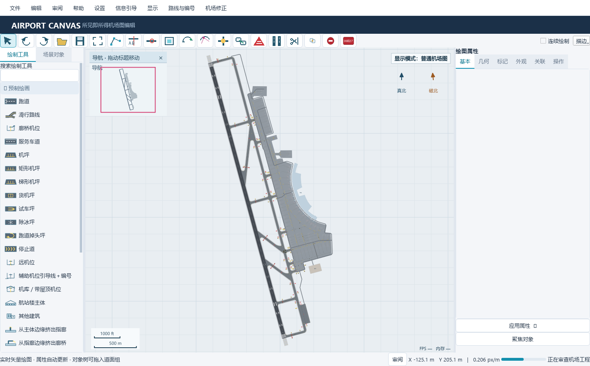
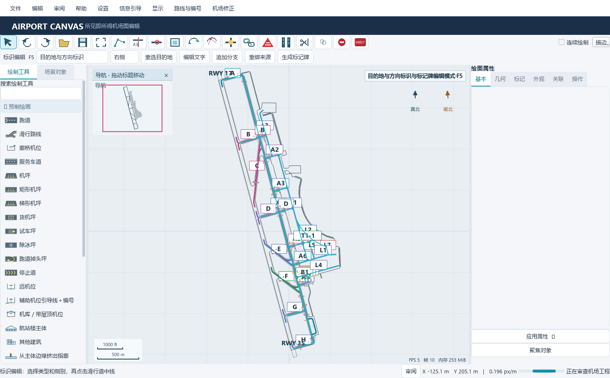
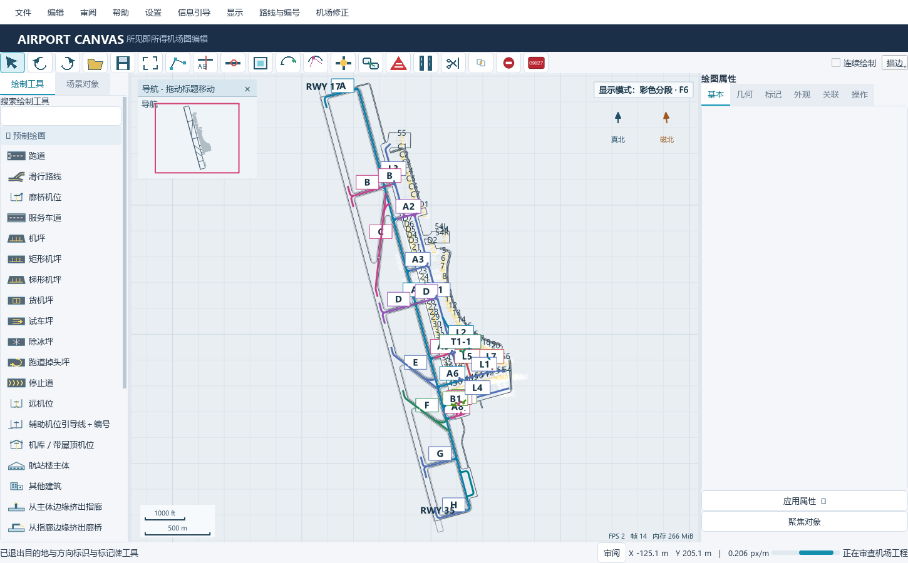
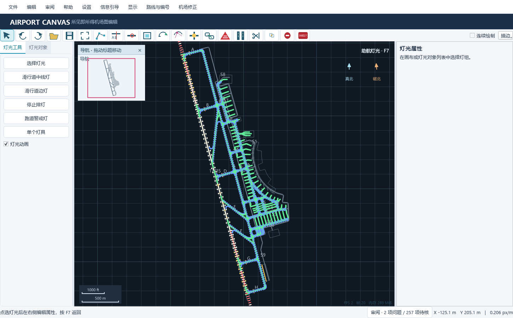
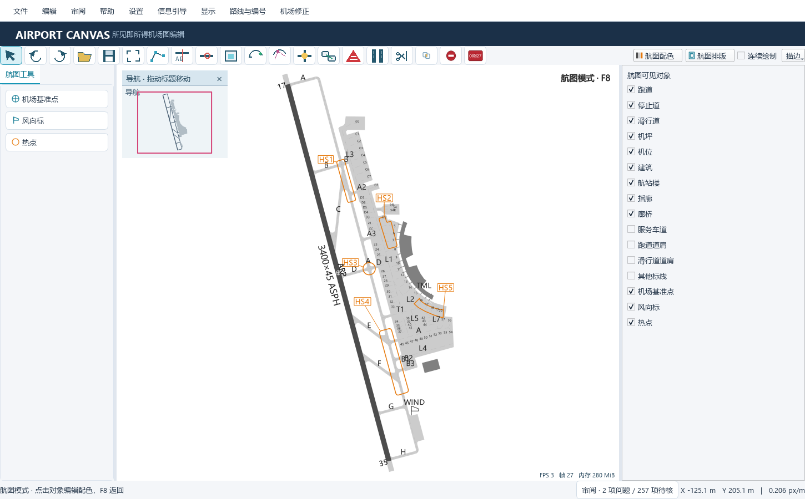
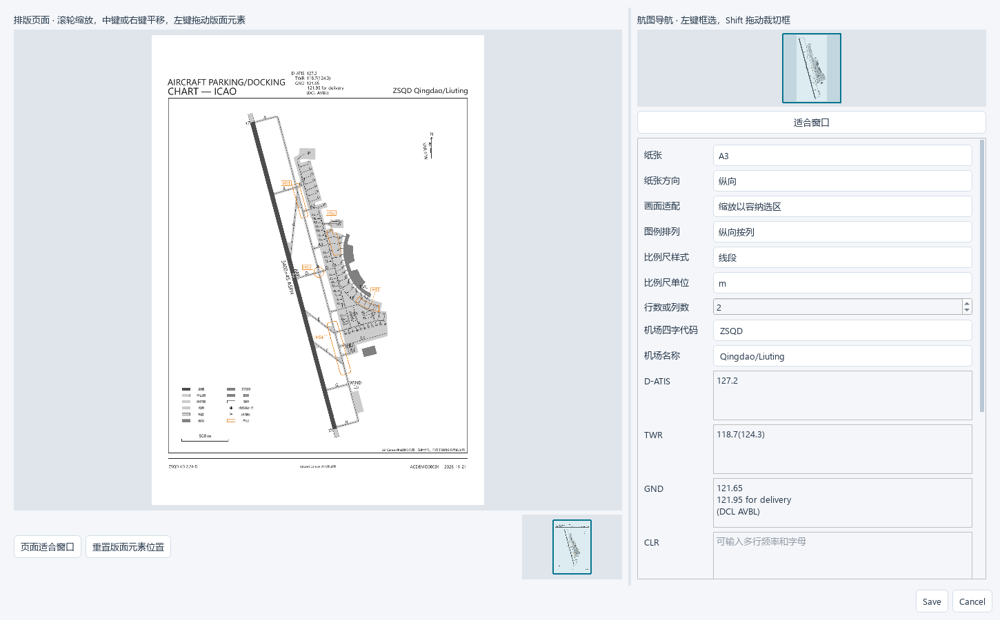

# Airport Canvas

[项目门户 / Project website](https://rxlx-china.github.io/Airport-Canvas/) · [最新版本 / Latest release](https://github.com/RXLX-CHINA/Airport-Canvas/releases/latest)

**Airport Canvas** 是一款 Windows 桌面机场绘图编辑器，用于绘制可编辑的机场平面图、配置助航灯光和排版模拟航图。它适用于机场布局学习、模拟场景设计和制图。软件中的审阅提示用于辅助检查，模拟航图仅供学习，不用于实际导航。

作者 · **刃下狼血**  
版本 · **v1.0**  
许可证 · **GPL-3.0-only**

[English](#english) · [快速入门](src/airport_canvas/QUICK_START.md) · [完整手册](src/airport_canvas/USER_GUIDE.md) · [图文教程](https://rxlx-china.github.io/Airport-Canvas/Airport-Canvas-1.2-Tutorial.html) · [更新日志](https://rxlx-china.github.io/Airport-Canvas/Airport-Canvas-Changelog.html)

## 特色工作流

以下截图均来自 Airport Canvas v1.0 中打开的 ZSQD 示例。按 F5–F8 可以从不同角度查看同一个 ACP 工程。

### 1. 直接在机场图上编辑几何



左侧选取跑道、滑行道或机坪工具，中间画布用来放置和检查几何，右侧用来调整所选对象的参数。需要改变线路走向时，可以用节点编辑工具调整控制点，再切换到 F6 检查这一段如何接入相邻线路。想从现有设计入手，可以打开 ZSQD，另存副本后再编辑。

### 2. F5 检查地面标识和标记牌



放大一个滑行道交叉口，观察标记牌的箭头、文字和对应分支。绘制目的地与方向地面标识时，先在滑行道中线上定位，再选目的地。对左右分流的路口，可以在同一处检查两侧方向。F5 适合把整套导向系统放在一起检查，包括跑道等待位置附近的标记牌。

### 3. F6 用颜色读懂滑行道网络



普通机场图便于看道面形状，F6 便于追踪线路。沿同一条滑行道看分段编号，放大交叉口检查转弯引导线，再沿快速脱离道追踪跑道侧的引入线。修改几何或重新编号后，这个视图适合复核连接关系。

### 4. F7 在深色画布上查看和编辑灯光



进入 F7 后，左侧换成灯光工具与场景对象。放大跑道端或等待位置，点击灯光对象，在右侧查看对应属性。可以对照跑道、滑行道与等待位置的灯光布置，检查不同类型灯光在平面上的位置。演示动态灯光时，可用灯光 GIF 导出保留动画。

### 5. F8 从机场工程生成模拟航图



在右侧控制航图上显示哪些对象，也可以选中对象调整线色和道面色。左侧工具可添加机场基准点、风向标和热点。跑道尺寸标注和机场图形来自同一个 ACP 工程，适合在布局变更后继续维护航图。



在 F8 打开「航图排版」，选纸张和裁切范围，检查图框、指北针、图例和比例尺。然后填写页眉、频率、注记等参数，调整图内图例与标注位置，再预览整页。排版配置随 ACP 保存，后续可以继续编辑并按 F8 模式导出。


## 主要功能

| 功能 | 可以做什么 |
| --- | --- |
| 机场平面绘图 | 绘制跑道、停止道、滑行道、机坪、机位、服务车道及建筑。用节点编辑、吸附和属性面板调整几何与标注。 |
| 滑行引导 | 编辑滑行道分段、转弯引导线、增强型中线、等待位置、目的地与方向标识及标记牌。 |
| 助航灯光 | 在 F7 查看和编辑灯光对象及其构型，包括跑道、滑行道、等待位置灯光和 PAPI。支持灯光动画及 GIF 导出。 |
| 航图排版 | 在 F8 设置颜色、基准点、热点、图例、比例尺、指北针、图框与裁切范围。 |
| 底图与工程 | 导入位图并校准比例，用可编辑的 `.ACP` 工程保存设计。附带已移除底图的 ZSQD 示例。 |
| 导出与工作环境 | 导出 PNG、SVG 和灯光 GIF。支持中英文界面、深色模式、自定义快捷键及工程审阅。 |

## 快速开始

1. 如果仓库的 **Releases** 已提供 Windows x64 成品，请下载绿色版或安装版。绿色版需解压整个 ZIP，再运行 `AirportCanvas.exe`。安装版会注册 `.ACP` 文件图标及打开命令，如需切换已有默认应用，可在 Windows「默认应用」中选择 Airport Canvas。
2. 启动后打开仓库附带的 [ZSQD.ACP](src/airport_canvas/ZSQD.ACP)，或新建空工程。
3. 在左侧选择绘制工具，按画布提示放置节点，在右侧修改属性。用 `Ctrl+S` 保存，在「文件」中选择导出模式与范围。

| 默认快捷键 | 用途 |
| --- | --- |
| `F5` | 目的地与方向标识及标记牌模式 |
| `F6` | 滑行道彩色分段与引导线模式 |
| `F7` | 助航灯光模式 |
| `F8` | 航图模式 |
| `Alt+Enter` / `Alt+N` | 工程网格朝上 / 真北朝上 |
| `Ctrl+N` / `Ctrl+O` / `Ctrl+S` | 新建 / 打开 / 保存 |
| `Ctrl+Z` / `Ctrl+Y` | 撤销 / 重做 |
| `Enter` / `Esc` | 确认绘制 / 取消当前操作 |

在「设置 → 自定义快捷键」查看完整绑定或更改按键。

## 从源码运行和构建

在仓库根目录打开 PowerShell。开发和构建使用 **Windows x64、Python 3.12 x64**。Nuitka 构建需要 Visual Studio C++ Build Tools，安装包还需要 Inno Setup。最终用户运行构建好的 EXE 时无需另装 Python。

```powershell
py -3.12 -m pip install -r requirements.txt
py -3.12 src/airport_canvas/gui.py
```

构建绿色版和安装版。把 `ISCC.exe` 路径换成你的实际安装位置。

```powershell
py -3.12 -m pip install Nuitka
py -3.12 build_windows.py --iscc "D:\Program Files\Inno Setup 7\ISCC.exe"
```

单独构建绿色版时使用 `py -3.12 build_windows.py --portable-only`。产物位于 `release/`。如果 `py` 找不到 Python，可在确认 `python --version` 指向 3.12 后，用 `python` 代替 `py -3.12`。

## 仓库导览

```text
src/airport_canvas/   Application modules and runtime resources
docs/images/          Screenshots used by this README
build_windows.py      Windows build entry point
AirportCanvas.iss     Inno Setup configuration
requirements.txt      Python dependencies
COPYING               GPLv3 license text
```


| 文件 | 用途 |
| --- | --- |
| [gui.py](src/airport_canvas/gui.py) | PySide6 桌面程序入口 |
| [build_windows.py](build_windows.py) / [AirportCanvas.iss](AirportCanvas.iss) | Nuitka 打包和 Inno Setup 安装器配置 |
| [VERSION.json](src/airport_canvas/VERSION.json) / [RELEASE_MANIFEST.json](src/airport_canvas/RELEASE_MANIFEST.json) | 版本元数据、构建文件与动态导入清单 |
| [ZSQD.ACP](src/airport_canvas/ZSQD.ACP) | 可编辑示例工程 |
| [FEATURES.md](src/airport_canvas/FEATURES.md) / [USER_GUIDE.md](src/airport_canvas/USER_GUIDE.md) | 功能介绍和完整使用手册 |
| [LICENSE.md](src/airport_canvas/LICENSE.md) / [COPYING](COPYING) | 许可说明和 GPLv3 正文 |

## 许可与作者

Airport Canvas 自有代码采用 **GPL-3.0-only**。第三方库、字体及素材各自适用其许可证。发行二进制时请一并提供对应版本的源代码与构建脚本。

**刃下狼血** · [Bilibili](https://space.bilibili.com/193006350) · [GitHub](https://github.com/RXLX-CHINA)

## English

**Airport Canvas** is a Windows desktop editor for drawing editable aerodrome plans, configuring aeronautical ground lighting and laying out simulated charts. It is intended for learning, simulation and drafting. Simulated charts are for educational use only and must not be used for actual navigation.

- **Aerodrome drawing** includes runways, stopways, taxiways, aprons, stands, service roads and buildings. Edit geometry with node tools and snapping, then adjust properties in the inspector.
- **Specialized views** cover destination and direction markings and signs (`F5`), taxiway segmentation and guidance (`F6`), ground lighting (`F7`) and chart layout (`F8`).
- **Projects and exports** include editable `.ACP` files, calibrated bitmap backgrounds, PNG and SVG export, and animated lighting GIFs. The bundled ZSQD example has no background bitmaps.
- **Workspace** includes Chinese and English interfaces, dark mode, custom keyboard shortcuts and project review.

If Windows x64 downloads are available under **Releases**, extract the entire portable ZIP and run `AirportCanvas.exe`, or use the installer for Start menu and `.ACP` file integration. Open [ZSQD.ACP](src/airport_canvas/ZSQD.ACP) to explore the editor. See the [English quick start](src/airport_canvas/QUICK_START_EN.md) and [feature overview](src/airport_canvas/FEATURES_EN.md).

To run from source, install requirements with `py -3.12 -m pip install -r requirements.txt` and run `py -3.12 src/airport_canvas/gui.py`. To build, use Windows x64, Python 3.12 x64, Visual Studio C++ Build Tools, Nuitka and Inno Setup. Run `py -3.12 build_windows.py --iscc "PATH_TO_ISCC.exe"` with the actual compiler path. Use `--portable-only` for the portable build. Outputs are written to `release/`.

### Illustrated workflows

The screenshots above use the included ZSQD project. Start with the [main editor](docs/images/01-editor.png) to adjust geometry and object properties. Use [F5](docs/images/02-signs.png) to inspect signs and pavement markings at junctions, then [F6](docs/images/03-taxiways.png) to trace individual taxiway segments and turn guidance. In [F7](docs/images/04-lighting.png), select lighting objects and inspect their settings. Use [F8](docs/images/05-chart.png) to choose what appears on the chart, then open the [layout dialog](docs/images/06-layout.png) to compose the page and preview it before export.

Airport Canvas's original code is licensed under **GPL-3.0-only**. See [COPYING](COPYING). Third-party materials retain their respective licenses.

**Author** · 刃下狼血 · [Bilibili](https://space.bilibili.com/193006350) · [GitHub](https://github.com/RXLX-CHINA)

